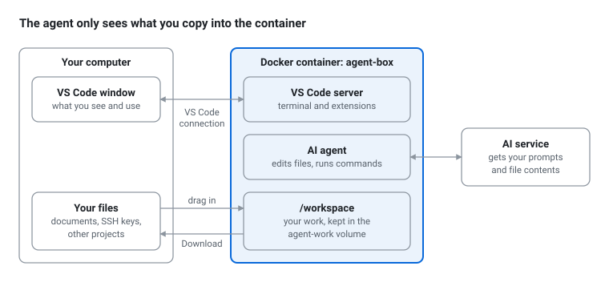

# Running AI agents safely in a Docker container

## What this setup does

The agent runs inside a Docker container, and VS Code connects to it. The agent can change anything in the container, but no folder on your computer is shared with it.

A container is a small Linux system with its own files, running on your computer. VS Code shows the container's files and terminal, and the agent (GitHub Copilot by default) works there. It can create, change and delete files and run commands, but it cannot see your documents, SSH keys, browser data or other projects. You decide which files go in and which come out.



Nothing from your computer reaches the container unless you drag it in. The two links out of the container, VS Code's connection and the internet, are covered in the [safety section](#what-this-protects-against-and-what-it-doesnt) below.

This is a guard against mistakes, not a vault. It reliably stops an agent from deleting or overwriting your own files. VS Code's connection to the container is a bridge to your computer, so read what the setup does not protect against before you give the agent untrusted content.

The guide uses GitHub Copilot, which is free for verified teachers. If you prefer Claude Code or OpenAI Codex, a [short section after step 7](#using-claude-code-or-openai-codex-instead) shows how to add them.

Please do steps 1 to 5 before the workshop. The first start downloads several hundred megabytes.

## Step 1: Install Docker, VS Code and the Dev Containers extension

Install [Docker Desktop](https://www.docker.com/products/docker-desktop/) on macOS or Windows, or [Docker Engine](https://docs.docker.com/engine/install/) on Linux, and start it. On Windows, Docker Desktop sets up WSL 2 during installation. Check that Docker works by running this in a terminal:

```
docker run --rm hello-world
```

Then install [VS Code](https://code.visualstudio.com/) and, from its Extensions view, the **Dev Containers** extension by Microsoft (`ms-vscode-remote.remote-containers`).

## Step 2: Stop VS Code from sharing your credentials

By default, VS Code passes your Git settings, your saved Git logins and your SSH agent into every container it opens. That is handy for developers, but it hands the agent your identity. Switch most of it off before you open the container.

In VS Code, open the Command Palette (Ctrl+Shift+P, or Cmd+Shift+P on a Mac), run **Preferences: Open User Settings (JSON)** and add these lines inside the outer braces:

```json
"dev.containers.copyGitConfig": false,
"dev.containers.gitCredentialHelperConfigLocation": "none",
"dev.containers.dockerCredentialHelper": false,
```

These lines stop VS Code from copying your Git settings and from setting up Git in the container to use your logins. One gap remains: a program in the container can still ask VS Code for your saved Git logins, so treat them as within the agent's reach.

VS Code has no setting for the SSH agent. In a terminal on your computer, run `ssh-add -l`. If it lists keys, run `ssh-add -D` to empty the agent; your key files are not touched. If it cannot connect to an agent, there is nothing to do.

These settings apply to every dev container you open. If you use VS Code profiles, add them to the profile you will use in the workshop. Delete the lines afterwards if you want the old behaviour back.

## Step 3: Get the setup folder

Download [agent-sandbox.zip](agent-sandbox.zip) and unzip it. It holds the two files below in a `.devcontainer` folder, which your file manager may hide because the name starts with a dot. If you prefer to make the folder yourself, create a folder called `agent-sandbox` with a subfolder `.devcontainer`, and save the two files there. On Windows, make sure your editor does not add `.txt` to the file names.

`.devcontainer/devcontainer.json`:

```jsonc
{
  "name": "Agent sandbox",
  "build": { "dockerfile": "Dockerfile" },

  // Your work lives in a Docker volume called agent-work.
  // No folder from your computer is mounted into the container.
  "workspaceMount": "source=agent-work,target=/workspace,type=volume",
  "workspaceFolder": "/workspace",

  "runArgs": ["--name=agent-box", "--hostname=agent-box", "--security-opt=no-new-privileges"],
  "remoteUser": "agent",
  "updateRemoteUserUID": false,

  // Hide your SSH agent from programs in the container.
  "remoteEnv": { "SSH_AUTH_SOCK": "" },

  "customizations": {
    "vscode": { "extensions": ["GitHub.copilot-chat"] }
  }
}
```

`.devcontainer/Dockerfile`:

```dockerfile
FROM node:24-slim

# Tools the agent can use. Add anything your session needs.
RUN apt-get update && apt-get install -y --no-install-recommends \
      git curl ca-certificates less nano ripgrep jq zip unzip procps \
      python3 python3-pip python3-venv \
    && rm -rf /var/lib/apt/lists/*

# GitHub Copilot CLI, for the stricter terminal option at the end.
RUN npm install -g @github/copilot

# A normal user without admin rights. The agent runs as this user.
RUN useradd --create-home --shell /bin/bash agent \
    && mkdir /workspace && chown agent:agent /workspace

USER agent
RUN git config --global user.name "Agent sandbox" \
    && git config --global user.email "agent@example.invalid" \
    && git config --global init.defaultBranch main
WORKDIR /workspace
CMD ["bash"]
```

The agent has no admin rights in the container, so it cannot change the installed tools. If it needs another system package, add it to the `apt-get` line and rebuild (see [Everyday tasks](#everyday-tasks)).

## Step 4: Open the folder in the container

In VS Code, choose **File → Open Folder** and pick `agent-sandbox`. If VS Code asks whether you trust the folder, say yes; it only holds the setup files. Then click **Reopen in Container** in the pop-up, or run **Dev Containers: Reopen in Container** from the Command Palette. The first start takes a few minutes.

When it is ready, the bottom-left corner of VS Code shows **Dev Container: Agent sandbox**. Open a terminal in VS Code with **Terminal → New Terminal**. The prompt should read `agent@agent-box:/workspace$`. Everything in this window, including the Explorer, the terminal and the agent, now works inside the container.

Next time, open the `agent-sandbox` folder and choose Reopen in Container again, or pick the container from **File → Open Recent**.

## Step 5: Sign in to GitHub Copilot

Verified teachers get Copilot Pro free through [GitHub Education](https://github.com/education/teachers). Apply with proof of your academic position, and do it early because approval can take a while. Without it, signing in gives you the Copilot Free plan, which has a small monthly allowance.

In the container window, hover over the Copilot icon in the Status Bar (bottom right), select **Use AI Features** and sign in with GitHub. Then open the [Chat view](https://code.visualstudio.com/docs/agents/run/chat-view).

Check that the agent really works in the container: ask it to run `hostname` and `whoami` in the terminal. It should report `agent-box` and `agent`. If it shows your own computer's name, stop and go back to step 4.

## Step 6: Move files in and out

To copy files in, drag them from your computer's file manager onto the Explorer panel in VS Code. Folders work too. VS Code copies them into the container, and your originals stay as they are.

To copy files out, right-click a file or folder in the Explorer and choose **Download**. Save it to a new folder rather than over your originals, and look it over before you use it.

If you prefer the command line, `docker cp` works with the container name `agent-box`. These assume you have a folder called `my-course` that has the content you want copied over. Run these in a terminal on your computer, not in VS Code's terminal, which runs inside the container:

```
docker cp my-course agent-box:/workspace/
docker exec -u root agent-box chown -R agent:agent /workspace
docker cp agent-box:/workspace/my-course ./my-course-from-agent
```

The second line is needed because `docker cp` makes copied files belong to root, so the agent could read them but not edit them.

Your files live in the `agent-work` volume. They survive closing VS Code and rebuilding the container.

## Step 7: Work with the agent

Give the agent tasks in the Chat view. It edits files in `/workspace` and runs commands in the container's terminal.

Before it starts, put your folder under Git so you can see and undo every change. In the container terminal, run this inside your folder:

```
git init && git add -A && git commit -m "Before the agent"
```

The Source Control view then shows each file the agent changed.

The chat input has a permissions menu. **Manual permissions**, the default, asks before actions you have not approved in advance. **Allow all** lets the agent work without asking. Allow all cannot reach your own files from this container, so it is fine for work on your own materials. Stay on Manual permissions when the agent reads things you don't control, such as web pages or student submissions. Never approve a request to install a VS Code extension or change VS Code settings.

The model picker in the chat input lets you choose between models from different companies that your Copilot plan includes.

## Using Claude Code or OpenAI Codex instead

Both come as VS Code extensions that run inside the container. In the container window, open the Extensions view, search for the extension and click **Install in Dev Container: Agent sandbox**. Then open its panel and sign in.

For **Claude Code**, search for *Claude Code* by Anthropic. It needs a Claude Pro, Max, Team or Enterprise plan, or an Anthropic Console account; the free Claude plan does not include it. See [Claude Code in VS Code](https://code.claude.com/docs/en/vscode).

For **Codex**, search for *Codex* and pick *Codex – OpenAI's coding agent* by OpenAI. Sign in with your ChatGPT account or an OpenAI API key. See [Codex authentication](https://developers.openai.com/codex/auth).

Extensions you install this way are removed when you rebuild the container. To avoid reinstalling them each time, add them to the `extensions` list in `devcontainer.json`, which is in the `.devcontainer` folder on your computer, and rebuild. Use `anthropic.claude-code` for Claude Code and `openai.chatgpt` for Codex. For example:
 
```jsonc
  "customizations": {
    "vscode": { "extensions": ["GitHub.copilot-chat", "anthropic.claude-code"] }
  }
```
 
Their logins also live inside the container, so you still need to sign in again after each rebuild. Each extension has its own approval setting, and the advice in step 7 applies to them too.

## Everyday tasks

Commands in backticks run in a terminal on your computer; the rest are VS Code menus and Command Palette entries.

| Task | How |
| --- | --- |
| Go back to your container | Open the `agent-sandbox` folder and choose **Reopen in Container**, or use **File → Open Recent**. |
| Open a terminal in the container | **Terminal → New Terminal** in the container window. |
| Leave the container | **File → Close Remote Connection**. The container stops; your files stay. |
| Apply changes to the Dockerfile | **Dev Containers: Rebuild Container**. Files in `/workspace` stay. |
| Delete the container | `docker rm -f agent-box`. Files in the `agent-work` volume stay. |
| Delete your work for good | `docker rm -f agent-box`, then `docker volume rm agent-work`. |

## What this protects against, and what it doesn't

The container keeps the agent away from your files not inside the container. It does not make the agent trustworthy.

It protects your computer from the agent's mistakes. The agent cannot read, change or delete your files, and it cannot install software on your computer. If it wrecks the container, rebuild it; your files in `/workspace` survive.

The container has internet access, because the agent needs it. Anything you put in the container can leave it: to the AI provider by design, and elsewhere if the agent is tricked by instructions hidden in a web page or document. Only add material you would share with the AI provider. Leave out passwords, API keys and student data, unless your institution allows sending that data to the provider.

The agent's login lives in the container, and so does anything else you sign in to there. You can delete the container after the workshop.

VS Code links the container to your computer. It opens links in your browser and forwards ports, and an extension running in the container can ask VS Code to run commands on your computer. Step 2 turns off most credential sharing, but someone who takes over the agent could still use this link, for example to fetch your saved Git logins or to install a malicious extension. When the agent works with content you don't trust, use the [stricter option below](#stricter-option-a-terminal-agent-without-vs-code), or at least keep Manual permissions. The [SEAL guide on developer machine confinement](https://frameworks.securityalliance.org/devsecops/isolation/developer-machine-sandboxing/) explains these risks in more detail.

Files you download are not checked. Read any script before you run it on your own computer, where it would have full access.

Keep the walls up: do not mount folders from your computer, do not mount `/var/run/docker.sock`, and do not add `--privileged` or `--network=host`. As [VS Code's own guidance](https://code.visualstudio.com/docs/agents/concepts/trust-and-safety) puts it, a dev container is only as isolated as its configuration.

## Stricter option: a terminal agent without VS Code

When the agent will handle content you don't trust, run GitHub Copilot CLI in a plain container instead. VS Code is not connected, so there is no bridge to your computer. You move files with `docker cp`.

In a terminal on your computer, inside the `agent-sandbox` folder, build the image and start the container:

```
docker build -t agent-sandbox .devcontainer
docker run -it --name agent-cli --hostname agent-cli --security-opt no-new-privileges -v agent-cli-work:/workspace agent-sandbox
```

You are now in a shell inside the container. Start the agent:

```
copilot --disable-builtin-mcps
```

If it asks you to sign in, type `/login`. It shows a link and a code; open the link on your computer, enter the code and approve. The flag turns off Copilot's built-in tools that act on your GitHub account. Since nothing else is connected, you can let it work without prompts by adding `--allow-all`.

Move files from a second terminal on your computer:

```
docker cp my-course agent-cli:/workspace/
docker exec -u root agent-cli chown -R agent:agent /workspace
docker cp agent-cli:/workspace/my-course ./my-course-from-agent
```

Type `exit` to leave the container. `docker start -ai agent-cli` takes you back in, and `docker rm agent-cli` deletes the container; your files stay in the `agent-cli-work` volume until you remove it.

## Troubleshooting

| Problem | Fix |
| --- | --- |
| VS Code cannot connect to Docker | Start Docker Desktop, wait until it reports that it is running, and try again. |
| VS Code does not offer Reopen in Container | Check the files are named exactly `.devcontainer/devcontainer.json` and `.devcontainer/Dockerfile`, with no `.txt` ending. |
| The build fails during `apt-get` or `npm` | Usually a network problem. Try again on a better connection. |
| "Container name /agent-box is already in use" | Run `docker rm -f agent-box` (your files in `agent-work` stay) and reopen the container. |
| The agent cannot install a system package | It has no admin rights by design. Add the package to the Dockerfile and run **Dev Containers: Rebuild Container**. |
| pip says "externally-managed-environment" | Use a virtual environment: `python3 -m venv .venv && . .venv/bin/activate`. |
| The agent cannot edit files copied with `docker cp` | Run the `chown` command from step 6. |
| Codex says its sandbox cannot start | Its own sandbox may not work inside Docker. Choose its full-access mode; the container is the sandbox. |

## Sources

- [VS Code: Developing inside a container](https://code.visualstudio.com/docs/devcontainers/containers)
- [VS Code: Manage approvals and permissions](https://code.visualstudio.com/docs/agents/run/approvals)
- [VS Code: Trust and safety for AI agents](https://code.visualstudio.com/docs/agents/concepts/trust-and-safety)
- [SEAL: Developer machine confinement](https://frameworks.securityalliance.org/devsecops/isolation/developer-machine-sandboxing/)
- [GitHub Education for teachers](https://github.com/education/teachers)
- [Claude Code in VS Code](https://code.claude.com/docs/en/vscode)
- [Codex authentication](https://developers.openai.com/codex/auth)
- [Report: VS Code still serves host Git logins with these settings](https://github.com/glunk-works/claude-workbench/issues/720)
